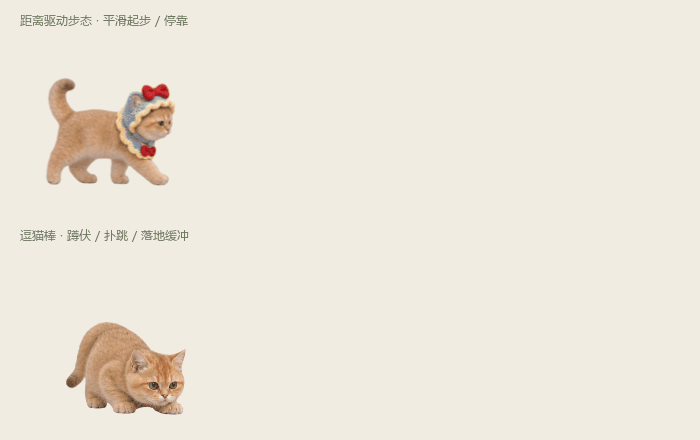

# 猫在 · CatMate

**猫在**是一只住在 Windows 桌面上的写实金渐层。它会散步、舔毛、伸懒腰，也会在你专注时趴下来睡觉。双击小猫即可打开中文小屋，喂食、换装、玩玩具，或开启工作计时。

Windows 10 1903+ / Windows 11（x64） · Python + PySide6 · 版本 **1.2.0**



[猫咪小屋](docs/previews/home.png) · [换装](docs/previews/wardrobe.png) · [工作记录](docs/previews/work.png) · [六套服装动作](docs/previews/costume-actions.png)

## 功能

- **桌面陪伴**　小猫在透明置顶窗口里活动，会根据时段和精力切换习性，也可以到桌面图标上方睡觉。支持摸头、拖拎、固定位置、50%–175% 缩放和省电模式。
- **三种玩具**　点击桌面抛毛线球，小猫有时会把球叼走。移动鼠标可以用逗猫棒引它扑跳，或让它追踪激光笔红点。
- **喂食与换装**　新存档有 200 枚猫爪币，可用来兑换食物、玩具和装扮。六套服装适配走路、睡觉、扑跳等动作，生日、圣诞、元旦和春节可领取相应套装。
- **工作与专注**　手动开始计时，可设时薪、查看预计收入和导出 CSV。工作每满一分钟获得 2 枚猫爪币，完成一轮专注获得 50 枚。可设喝水与休息提醒。
- **快捷启动**　从右键菜单或系统托盘打开常用软件。支持添加 `.exe` 和 `.lnk`、查找已安装的豆包及打开豆包网页版。可在偏好设置里开启 Windows 登录启动。

## 快速开始

**已有 Windows 便携包**时，解压后双击 `CatMate.exe`。便携包已包含 Python 和 Qt，迁移时请复制整个 `CatMate` 文件夹。

**从源码运行**时，请安装 Python 3.14 x64，并在项目根目录打开 PowerShell。

```powershell
python -m venv .venv
.\.venv\Scripts\python.exe -m pip install -r requirements.txt
.\.venv\Scripts\python.exe main.py
```

也可先双击 [`setup.cmd`](setup.cmd)，安装完成后双击 [`启动猫在.cmd`](启动猫在.cmd)。

| 操作 | 效果 |
| --- | --- |
| 双击小猫 | 打开猫咪小屋 |
| 单击或轻抚头部 | 摸头 |
| 按住小猫拖动 | 拎起并移动小猫 |
| 右键小猫 | 调大小、切换省电模式、快捷启动软件或退出 |
| 玩耍时按 `Esc` | 结束玩耍 |
| 关闭小屋 | 小猫继续留在桌面，可从托盘再次打开小屋 |

## 存档与计时

Windows 默认存档路径为 `%LOCALAPPDATA%\CatMate\save.json`，日志在同一目录的 `catmate.log`。应用会定期保存，并在关键操作后写入存档。迁移前请退出小猫，再复制整个存档目录。核心功能可离线使用，存档保存在本地。

工作和专注默认在电脑闲置五分钟后暂停，回来后恢复。电脑休眠期间暂停计时，退出后再次运行需手动开始。工作记录按本地日期归档，修改时薪只影响之后的记录。预计收入按自设时薪计算，猫爪币是应用内积分。

源码入口和便携版均支持 `--quiet`（只显示小猫）、`--data-dir`（指定存档目录）和 `--quit`（退出使用同一存档目录的实例）。

## 构建与验证

维护者可参考[分支、版本标签和 GitHub 发布流程](docs/releasing.md)。本版的下载与升级说明见 [v1.2.0 发布说明](docs/releases/v1.2.0.md)。

Apple Silicon 上的 3D 技术预览已可从源码构建，见 [Mac 构建与操作指南](mac/README.md)。开发排期与验收节点见[首个 Mac 预览版开发计划](docs/development-plan-v1.3.0-alpha.1.md)，设计与交付范围见[项目架构说明](docs/architecture.md)和[预览版说明草案](docs/releases/v1.3.0-alpha.1.md)。

在 Windows x64 上，于项目根目录运行以下命令。`build.cmd` 会安装开发依赖，并用 PyInstaller 生成 `dist\CatMate\CatMate.exe`。

```powershell
python -m venv .venv
.\build.cmd
.\.venv\Scripts\python.exe -m unittest discover -s tests -v
.\.venv\Scripts\python.exe tools\verify_ui.py
.\.venv\Scripts\python.exe tools\verify_animation.py
.\.venv\Scripts\python.exe tools\verify_walk.py
.\.venv\Scripts\python.exe tools\verify_release.py
```

单元测试只依赖 Python 标准库。Qt 验证脚本使用临时存档，并生成界面、动画或步态预览。`verify_release.py` 检查便携包的启动、存档和单实例行为。

| 路径 | 内容 |
| --- | --- |
| [`catmate/`](catmate/) | 应用代码、桌宠窗口、动画、界面和存档 |
| [`assets/`](assets/) | 角色、服装、步态素材和应用图标 |
| [`tests/`](tests/) | 业务逻辑、存档和运动单元测试 |
| [`tools/`](tools/) | 验证、打包和离线素材生成脚本 |
| [`docs/`](docs/) | 功能验证记录、性能数据和预览 |

## 版本与兼容性

1.2.0 修复了走路、起停和转向时的叠影。裸猫和六套服装各有 24 个步态帧，走动时默认以约 60 Hz 刷新，省电模式降至约 30 Hz。步态素材可用 [`tools/bake_walk.py`](tools/bake_walk.py) 离线重建，依赖列在 [`requirements-assets.txt`](requirements-assets.txt)。[1.2 验证记录](docs/verification-v1.2.md) · [性能测试方法与数据](docs/performance-v1.1.md)

图标旁睡觉依赖 Windows Explorer。读取不到图标时，小猫会在普通位置睡觉。全屏独占应用可能遮住桌宠。春节套装的日期表目前覆盖 2026–2030 年。

## 素材与第三方许可

写实猫咪与服装素材由 AI 按项目参考照片生成。项目保留了[原始需求](需求.txt)以及[基础素材](docs/asset-prompts.json)、[逐动作服装](docs/action-outfit-prompts.json)和[扑跳素材](docs/pounce-prompt.json)的生成提示词。

Qt、PySide6、Python 和 PyInstaller 的许可详见 [第三方声明](THIRD_PARTY_NOTICES.md)及 [`licenses/`](licenses/)。

开发时参考了 [DesktopPet](https://github.com/Litrudy/DesktopPet) 和 [Desktop-Pets](https://github.com/LGaben/Desktop-Pets) 的桌宠交互。春节日期参考 [香港天文台公历与农历日期对照表](https://www.hko.gov.hk/en/gts/time/conversion.htm)。
