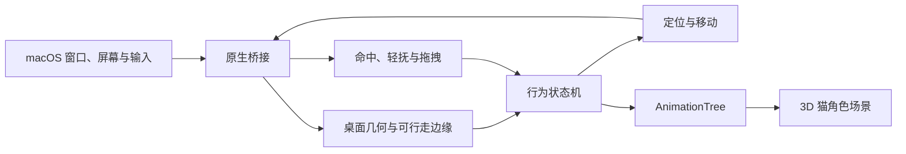

# CatMate 架构与 3D 桌宠设计

**设计基线**为 Windows x64 的 v1.2.0（提交 `8db70f8`）。后续产品以 Apple Silicon 上的自主 3D 小动物为方向。第一只角色沿用猫；猫的三维模型、骨骼和动作需要单独制作或取得再分发授权。现有 PNG 图集可作为外观和动作节奏参考。

## 当前版本如何运行

[入口](../main.py) 启动 Qt 事件循环。[Application](../catmate/app.py) 为同一存档目录维持单实例，负责托盘、桌宠窗口、按需打开的小屋和定期保存。桌宠动画、工作计时和写盘有各自的更新节奏。

| 模块 | 现有职责 | 对 3D 版本的意义 |
| --- | --- | --- |
| [model.py](../catmate/model.py)、[catalog.py](../catmate/catalog.py) | 管理库存、积分、节日、计时和 JSON 存档 | 保留规则和测试用例，作为以后移植养成系统的依据 |
| [pet.py](../catmate/pet.py)、[motion.py](../catmate/motion.py) | 接收触摸和拖拽，驱动玩具、位移、扑跳和帧调度 | 复用行为语义和轨迹测试，桌面位置与角色姿态分别建模 |
| [animation.py](../catmate/animation.py)、[assets/](../assets/) | 选择 2D 动作帧并绘制猫咪与服装 | 3D 运行时改由模型、骨骼和动画片段表达同一动作 |
| [ui.py](../catmate/ui.py)、[platform_win.py](../catmate/platform_win.py) | Qt 小屋、快捷启动、Windows 空闲检测和 Explorer 图标定位 | 桌面集成由各平台实现；macOS 窗口边缘与 Explorer 图标位置使用不同的数据模型 |

## 目标架构

Mac 预览版采用独立的 Godot 4 应用。行为逻辑使用 GDScript，角色场景通过 AnimationTree 混合动作。macOS 桥接建议用 GDExtension 加 Objective-C++ 接入 AppKit。第一阶段先验证透明窗口、点击命中和常驻能耗，再锁定 Godot 小版本、渲染后端和最低系统版本。[AnimationTree](https://docs.godotengine.org/en/stable/tutorials/animation/animation_tree.html) · [GDExtension](https://docs.godotengine.org/en/stable/tutorials/scripting/gdextension/what_is_gdextension.html)

| 边界 | 所有者与接口约定 |
| --- | --- |
| 平台与几何 | 桥接层交付显示器 ID、可用区域、缩放和可见窗口边界。转换为统一的左上原点、以逻辑点计量的桌面坐标，保留多屏负坐标。窗口标题和内容均无需进入行为层。[NSScreen](https://developer.apple.com/documentation/appkit/nsscreen) |
| 行为与移动 | 状态机接收时间、可达边缘和输入事件，输出动作与目标位置。移动模块计算猫脚底的桌面位置。拖拽优先于自主散步，松手时清除旧目标，并从当前位置重新选择落点。 |
| 定位与渲染 | 原生窗口承担跨桌面位移，角色场景在局部坐标中播放姿态；行走片段用原地循环，步频随实际位移调整，避免窗口位移和骨骼根运动重复叠加。 |
| 角色与动作 | 首版随包内置一只猫。定义脚底锚点、命中区域及 idle、walk 等逻辑动作名，角色资源负责映射到动画片段。后续增加坐、睡、跑、跳和替换角色时沿用这套约定。 |
| 数据与生命周期 | Mac 预览版使用独立偏好目录，记录屏幕位置、缩放及省电偏好。Windows 的积分、库存和历史记录由原存档管理；跨端迁移另行设计。菜单栏提供找回小猫和退出入口。 |

## 一个窗口边缘如何成为落脚点

第二阶段以“猫站在窗口顶边”为第一个可验收场景。保存窗口标识、边缘及脚底在边上的相对位置。窗口移动后按新矩形重算脚底，窗口缩窄时将位置夹回可用边段。窗口关闭、最小化、被遮挡或切换空间后，重新确认可见支撑；找不到安全边缘时，回落到当前屏幕可用区域。显示器拔除时，在剩余显示器内重新定位。

边缘感知的首个技术实验是对比系统提供的窗口几何在多屏、不同缩放和权限受限时的结果。桥接层应能返回“几何不可用”；此时屏幕内散步、摸头和拖动仍可工作。鼠标只有命中猫或在主动拖拽时才由桌宠处理，透明区域应可操作后方应用。

## 交付顺序与验收

| 阶段 | 体验 | 核验方法 |
| --- | --- | --- |
| 首个 Mac 预览 | 一只 3D 猫在透明桌面窗口中待机、自主散步、响应轻抚和拖拽 | 在 Apple Silicon 真机从导出的 arm64 应用启动，通过猫身和透明区点击、屏幕边缘松手、退出再启动验证完整操作 |
| 窗口感知 | 在可见窗口顶边站立、跟随、行走，随后加入边缘间跳跃 | 移动、缩放、最小化及关闭宿主窗口，验证脚底位置与回落；覆盖双显示器、不同缩放和显示器断开 |
| 长期陪伴 | 跑、坐、睡、追鼠标、低功耗、替换模型、登录启动 | 对比待机、走动、睡眠和隐藏时的帧间隔、CPU、内存、GPU/能源影响；在 Mac mini M4 记录长时间运行趋势及唤醒恢复情况 |

性能从首个预览就开始测量。建议首轮每种状态观察十分钟，记录硬件、系统、渲染后端和采样窗口；以同机空桌面为基线。长稳阶段再加入全天运行。历史 Windows 2D 测量仅用于原版本回归。AI 对话、屏幕内容分析和编码助手联动留作独立产品决策。
